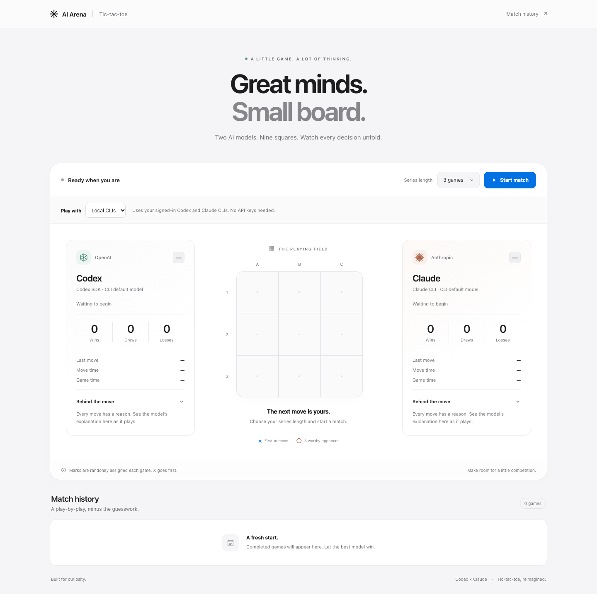

# AI Arena

Configure a Codex-versus-Claude tic-tac-toe match, then follow its moves, timings, and results.



## Quickstart: local CLIs, no API keys

Requires Python 3.10+, Node.js 20+, and Claude Code (`claude`) installed on your PATH.

```sh
python3 -m venv .venv
source .venv/bin/activate
pip install -r requirements.txt
npm ci
python app.py
```

Open [localhost:5001](http://localhost:5001). Choose the connection, Codex model, Claude model, and number of rounds, then select **Start match**. The board and results appear after the match starts; **New match** returns to setup.

- **Codex:** the installed `@openai/codex-sdk` uses its bundled Codex CLI and your existing ChatGPT sign-in. If needed, run `npx codex login` and choose ChatGPT. An existing Codex CLI login is reused. Local mode enforces ChatGPT authentication rather than API-key authentication.
- **Claude:** uses your installed `claude` command and existing subscription sign-in. Run `claude` once to sign in if needed.
- Local means the CLI runs on your computer; model inference still uses the providers’ services and your plan’s usage allowance. No API keys are required by this mode.

The selectors show concrete, versioned models reported by the CLIs. **Local CLIs** automatically selects the newest reported **Luna** and **Haiku**, including when switching back from another connection or creating a new match. These product defaults take precedence over older browser-saved choices and CLI recommendations for other model families. You can select any other listed model before starting; an existing match keeps its chosen models when refreshed.

Codex uses the SDK’s bundled CLI (or `CODEX_CLI_PATH`) and its paginated `model/list` catalog, including all models visible in that CLI’s picker. If live discovery is unavailable, it can use the CLI’s last metadata cache. Claude uses the installed command’s initialization metadata and resolves aliases to full model IDs. Model discovery sends no prompts and starts no inference turns. Metadata is cached in memory for up to five minutes. If no models are reported, the UI shows an unavailable state instead of a “CLI default” option. Defaults advance when the catalogs report newer Luna/Haiku versions; no unreported model is invented.

Each player has a **Reasoning effort** slider with that model’s supported levels. A vertical tick marks each stop, and the selected tick is highlighted. The chosen effort is saved with the match and sent to Codex as `modelReasoningEffort`, Claude as `--effort`, or the optional APIs as their effort parameter. **Default** on this slider keeps the adapter’s existing effort setting. The slider is disabled for models that don’t support effort and for Test players.

Copy `.env.example` for optional connection settings. `CODEX_CLI_PATH` selects a different installed Codex binary; otherwise the SDK uses its pinned runtime. No existing CLI configuration or credentials are changed.

## Choose a mode

| Connection | Players | Credentials |
| --- | --- | --- |
| **Local CLIs** (default) | Codex SDK + Claude CLI | Existing CLI sign-ins |
| **API keys** | Existing GPT 5.2 + Claude Opus 4.5 adapters | `OPENAI_API_KEY` and `ANTHROPIC_API_KEY` in `.env` |
| **Test** | Deterministic simulated players | None; no CLI, API, or LLM calls |

API clients are imported only when an API move is requested. You can start the app and play Local or Test games without configuring any API keys. A failed adapter never falls back to another provider or starts using API keys.

**Test without any real models:**

```sh
python app.py --test
```

`--test` (or `ARENA_TEST_MODE=1`) forces simulated players on the server, even if a client asks for Local or API mode. The UI shows a Test badge and locks the mode selector. Test moves always choose the first empty square; they exercise the game flow, not model quality. Use this option for manual testing and automation.

## Match controls

- **Who goes first:** X always plays first. Each new match randomly picks which model plays X in round 1; every later round swaps marks, so the first player alternates (for example Claude, Codex, Claude). Starting a new match picks at random again.
- **Pause** finishes a move already in progress, then stops. **Resume match** continues the same series.
- Refreshing restores an unfinished board in a paused state. Completed series stay visible until a new match begins.
- Failed starts stay on setup; failed moves stay on the match with a retry action. **New match** returns to model and round selection, where you can switch to Test.
- The board is the focus, with blue X / red O marks and a line through the winning three. Compact side panels show each model, connection, effort, current activity, last move, and latest explanation. **Statistics & timing** expands within each panel for current-series results and timing. On smaller screens, player names sit above the board and their details follow below. [View the match screenshot](static/img/match.png). Explanations are capped at 600 characters to keep browser sessions compact.
- **Match history** is the only section below the desktop arena. It reads the global archive from `data/match-history.json` through the read-only `/api/match-history` endpoint. The file starts as `{"matches": []}`; no match, round, reset, or API action appends to it. It stays empty for now. Current-series bookkeeping is kept separately in the browser session for scores, round progress, and resume; it never populates the archive.
- Keyboard focus, screen-reader status announcements, and reduced motion are supported. The frontend needs no build or external fonts.

The app binds to localhost and runs local processes under your account. The CLI adapters use an empty temporary working directory, disable command/web tools where supported, and time out after 180 seconds by default (`MODEL_TIMEOUT_SECONDS`). API credentials are removed from local child environments. Codex uses read-only permissions; Claude runs with tools disabled. Raw CLI diagnostics are not returned to the browser.

Flask stores the current series in a signed browser cookie. Without a stable `FLASK_SECRET_KEY`, restarting the server resets saved matches. Use one active match tab at a time; simultaneous tabs share the browser session.

## Tests — no real LLMs

```sh
# Backend/game routing and CLI adapter fixtures
.venv/bin/python -m unittest discover -s tests -v

# Installed Codex SDK against fake clients and a fake CLI event stream
npm test

# Browser checks; installs Chromium once
npx playwright install chromium --only-shell
npm run test:ui
```

Tests use captured model metadata and fake CLI initialization responses; no test invokes live discovery or real inference. The browser suite starts and stops its own servers on ports 5084/5085: one forced-Test server and one selector fixture with both real adapters blocked. It covers series completion, pause/resume, reload, provider switching, retry, compact side panels, read-only global history, all eight winning-line patterns in both mark colors, responsive layouts, and reduced motion. Set `ARENA_PYTHON` if your Python environment is elsewhere. SDK tests never invoke the real Codex binary. Live provider inference is intentionally outside this suite.

Integration references: [Codex SDK](https://learn.chatgpt.com/docs/codex-sdk), [Codex authentication](https://learn.chatgpt.com/docs/auth), and [Claude CLI automation](https://code.claude.com/docs/en/headless).
